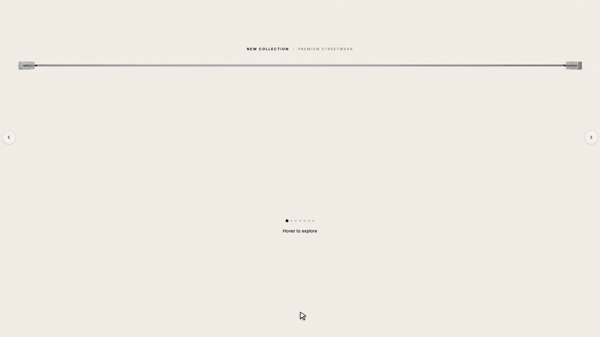

# Clothing Rack Section for Shopify

Show your products hanging on a real clothing rack. Garments sway like they are on hangers, turn to the front on hover, and open in a full product spotlight with Front / Back view, size selection and Add to Cart — all without leaving the page.

## Overview

This section displays products side-on along a rail, the way clothes hang in a store. Hovering a garment turns it to the front while its neighbours swing. Clicking it opens a spotlight popup where shoppers can switch between front and back images, browse other products, pick a size and add to cart. Everything is built with Liquid, CSS and plain JavaScript — no paid app required.

## Demo

> Hover, slide, drag, open the spotlight, switch Front / Back, browse products and add to cart.

## Features

- No paid apps required
- Realistic hanger sway on hover, slide, drag and scroll
- Hover turns the garment from side view to front view
- Slider with arrows, dots, auto-slide and click & drag (mouse and touch)
- Slides one product at a time
- Products per view set separately for desktop and mobile — garment size adjusts automatically
- Product spotlight popup with Front / Back toggle and next / previous product arrows
- Size buttons (shown only when the product has a Size option, sold-out sizes are crossed out)
- Add to Cart without page reload — updates the theme cart drawer and cart count (Horizon and Dawn-based themes)
- Custom rod image, hanger colour and price tags
- Colour and size settings for labels, price tags, arrows, popup title, price, toggle and Add to Cart button

## Getting Started

1. Go to your Shopify Admin → **Online Store** → **Themes**
2. Click **…** → **Edit code** on your active theme
3. In the **Sections** folder, click **Add a new section** and name it `clothing-rack`
4. Replace everything in the new file with the code from [`clothing-rack.liquid`](clothing-rack.liquid) and click **Save**
5. Open **Customize**, click **Add section** and choose **Clothing Rack**
6. Add a **Rack Item** block for each product

## Adding Products

Each **Rack Item** block has:

| Setting | Description |
|---|---|
| ① Side-view image | Side photo of the garment, shown on the rack (required) |
| ② Front-view image | Shown on hover and in the popup. Uses the product image if left blank |
| ③ Back-view image | Optional. Turns on the Front / Back toggle in the popup |
| Product | The product to link — used for name, price, sizes and Add to Cart |

> **Tip:** Use transparent PNG images with the same canvas size for side, front and back so the garment stays in the same place when it turns.

## Section Settings

| Group | What you can change |
|---|---|
| Colors | Background, text, rod, hanger, price tag background |
| Rod image | Upload a custom rod / rail photo |
| Slider | No slider, manual (arrows) or auto-slide, and auto-slide speed |
| Labels | Rail labels, caption, Front / Back tab text |
| Sizes | Max rack height (desktop / mobile), popup height, hover speed, padding |
| Products visible on screen | Products per view on desktop and on mobile |
| Rack styling | Rail label colour & size, price tag text colour & size, slider arrow colours & size |
| Popup styling | Product name, price, Front / Back toggle, next / previous arrows and Add to Cart button colours & sizes |

## Resources

- [Shopify Liquid Reference](https://shopify.dev/docs/api/liquid)
- [Shopify Cart AJAX API](https://shopify.dev/docs/api/ajax/reference/cart)
- [Section Schema Docs](https://shopify.dev/docs/storefronts/themes/architecture/sections/section-schema)

---

*Part of the [Free Shopify Sections](https://github.com/websensepro1/free-shopify-sections) collection.*
