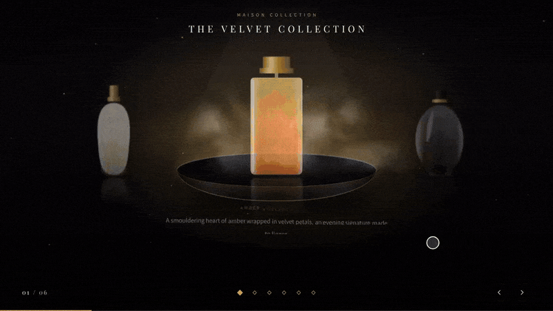

# Luxury 3D Scroll Showcase

A premium 3D product carousel for Shopify. Transparent product cutouts orbit around a glossy pedestal with real depth, smoke, a mirror reflection and a spotlight. It is built to make perfume bottles, watches, jewelry and other luxury products feel like a brand campaign.

> The preview uses illustrated placeholder bottles. Use your own transparent product images.

## Overview

The Luxury 3D Scroll Showcase section places your products on an elliptical orbit in 3D space. The product in the centre is scaled up, sharp and bright, while the others sit further back, smaller, dimmer and softly blurred. Visitors rotate the orbit with the mouse wheel, by dragging or swiping, with arrows and dots, or hands-free with auto-slide.

The orbit loops endlessly in both directions and uses spring-based motion, so rotation stays smooth instead of moving in stops and starts.

## Features

- True 3D orbit built with CSS 3D transforms (`perspective`, `translate3d`, `rotateY`, `scale`)
- Endless loop in both directions with smooth, spring-based motion
- Mouse wheel rotates the products **only while the cursor is over the 3D area**. Everywhere else the page scrolls normally
- Drag and swipe support on desktop and mobile
- Optional auto-slide with your own time per product
- Glossy pedestal, mirror reflection floor, spotlight and light beam
- Realistic rising smoke and floating gold dust (each can be turned off)
- Product title, notes, description, price and button animate in for the active product
- "Add to cart" or link button per product, with an AJAX add to cart
- Pulls product name, price and link from your Shopify products, with custom text overrides
- Fully responsive with a tuned mobile layout
- Theme editor friendly: selecting a product block rotates the carousel to it
- Respects `prefers-reduced-motion`

## Getting Started

1. Copy `luxury-3d-scroll-showcase.liquid` into your theme's `sections/` directory
2. Go to **Online Store → Themes → Customize** in your Shopify admin
3. Add the **Luxury 3D Scroll Showcase** section to your page template
4. Add a **Product slide** block for each product (3 to 8 products looks best, up to 12 are supported)
5. Pick a product and upload a transparent cutout image for each block
6. Save and publish your changes

## Preparing Your Images

Good images matter more than any setting.

- Use a **transparent PNG or WebP** of the bottle or product. Remove the background first
- Crop the image **tightly at the bottom** so the product stands on the pedestal and the reflection lines up. If it looks like it floats, raise **Lower product onto pedestal**
- Use images about 1000 to 1400 px tall with similar proportions across all products
- If you do not upload a cutout, the section falls back to the product's featured image. That only looks right if the featured image already has a transparent background

## Customization

### Section settings

| Group | Setting | What it does |
| --- | --- | --- |
| Interaction & layout | Section height | Height of the section as a percentage of the screen (60 to 100) |
| | Rotate with mouse wheel | Wheel rotates the products inside the 3D area only |
| | Enable drag / swipe | Drag with the mouse or swipe on touch screens |
| | Rotation smoothness | Seconds the motion takes to settle. Higher is slower and floatier |
| | Auto-slide | Moves to the next product automatically |
| | Auto-slide time | Seconds each product stays in focus (2 to 12) |
| | Pause on hover | Pauses auto-slide while the mouse is over the 3D area |
| | Show progress bar | Thin gold progress bar at the bottom |
| Orbit & products | Product height | Size of the products inside the stage |
| | Active / background scale | How big the centre product is and how small the others get |
| Heading | Eyebrow, Heading | Small text and title at the top |
| Content | Show price, label, title | Show or hide the price, the small label and the large product title |
| | Added / sold out labels | Button text after adding to cart or when sold out |
| Background | Gradient colors, spotlight | Dark gradient, spotlight color and intensity |
| | Background texture | Optional image with adjustable opacity |
| | Gold dust particles | Floating particles and their color |
| Pedestal & reflection | Pedestal, reflection | Toggle the podium and the mirror floor, with reflection intensity |
| | Smoke on pedestal | Toggle the smoke and set its intensity |
| | Lower product onto pedestal | Fine-tunes how far the product sits down on the podium |
| Typography & colors | Fonts, sizes, letter spacing | Heading and body fonts, title size, body size, tracking |
| | Accent and text colors | Gold accent and main text color |

### Product slide block settings

| Setting | What it does |
| --- | --- |
| Product | Auto-pulls the title, price and link |
| Product cutout | Transparent PNG or WebP. Falls back to the product's featured image |
| Small label | Short line above the notes (for example "Eau de Parfum"). Hidden by default |
| Custom title | Overrides the product title |
| Subtitle / notes | Comma separated notes, for example `Amber, Velvet, Rose` |
| Description | Overrides the product description |
| Button text | Text of the button |
| Button action | **Link** or **Add product to cart** |
| Button link | Leave blank to use the product page |

## How It Behaves

- **Inside the 3D area:** mouse wheel, drag, swipe, arrow keys, dots and arrow buttons all rotate the carousel
- **Outside the 3D area:** the mouse wheel scrolls the page as usual
- **Mobile:** swipe left or right to rotate, swipe up or down to scroll the page
- **Auto-slide:** restarts its timer whenever the visitor interacts, and pauses while the tab is hidden or the section is off screen

## Notes

- **GSAP:** the title and description reveal uses GSAP 3.12.5. It is loaded from a CDN (cdnjs, with jsDelivr as a backup) only if your theme has not already loaded GSAP. If it cannot load, the section still works without the text animation
- **Performance:** if a low-end device feels slow, turn off **Smoke on pedestal**, **Gold dust particles** or **Show reflection floor**
- **Smoke and particles** are drawn on a canvas and pause automatically when the section is off screen
- Built for Online Store 2.0 themes

## Resources

- [Shopify Theme Development Docs](https://shopify.dev/docs/storefronts/themes)
- [Liquid Template Language Reference](https://shopify.dev/docs/api/liquid)
- [Shopify Section Schema](https://shopify.dev/docs/storefronts/themes/architecture/sections/section-schema)

---

*Part of the [Free Shopify Sections](https://github.com/websensepro1/free-shopify-sections) collection.*
